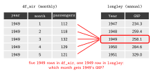
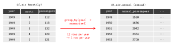
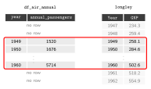
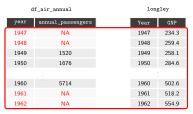

# Datasets in R {#sec-datasets}

```{r}
#| include: false
# Each chapter runs in a fresh R session: recreate df_air from @sec-intro
library(dplyr)
passengers <- as.numeric(AirPassengers)
year       <- as.numeric(floor(time(AirPassengers)))
month      <- as.numeric(cycle(AirPassengers))
df_air <- data.frame(year, month, passengers)
```

## Inspecting Dataframes

Before running any analysis, take a first look at the data: how large it is, which variables it contains, what values they take, and whether anything is missing. This helps to spot mistakes early, for example a merge that dropped observations or a variable stored in the wrong units.

We use `df_air`, the monthly passenger dataset created in @sec-intro, as an example.

### Size and structure

`dim()` returns the number of rows and columns, `names()` the variable names, and `str()` the type of each variable together with its first values:

```{r}
dim(df_air)
names(df_air)
str(df_air)
```

`head()`, used in @sec-intro, prints the first six rows, and `tail()` prints the last six:

```{r}
tail(df_air)
```

### Summary statistics

`summary()` returns the minimum, the quartiles, the mean and the maximum of a numerical variable:

```{r}
summary(df_air$passengers)
```

Applied to a whole dataframe, it summarises every variable at once:

```{r}
summary(df_air)
```

Individual statistics have their own functions, such as `mean()`, `median()`, `var()` (variance) and `sd()` (standard deviation):

```{r}
mean(df_air$passengers)
sd(df_air$passengers)
```

### Frequency tables

`table()` counts how many observations take each value of a variable. It is most useful for categorical variables. Here it confirms that every year has exactly 12 monthly observations:

```{r}
table(df_air$year)
```

## Selecting Subsets

Square brackets select parts of a dataframe by position, as `dataframe[rows, columns]`. Leaving the rows or the columns empty selects all of them. The `$` sign selects a single variable by its name.

```{r}
# Accessing data through row/column indexes
df_air[1:3,] # Rows 1 to 3, all columns.
df_air[c(2,5),c(1,3)] # Rows 2 and 5, Columns 1 and 3.
head(df_air[,c(1,3)]) # All rows, Columns 1 and 3 (first six rows shown).
```

```{r}
# Access the 'passengers' variable.
df_air$passengers
```

Generate a new dataset `df_air_first_9_rows` by selecting the first 9 observations/rows of the dataset:

```{r}
df_air_first_9_rows <- df_air[1:9,]
ls()
```

## Creating Variables

### From existing variables

A new variable is created by assigning a vector to a name that does not yet exist in the dataframe, with `dataframe$new_variable <- ...`. The vector is usually computed from existing variables. `passengers` is measured in thousands, so dividing it by 1000 gives the number of passengers in millions:

```{r}
df_air$passengers_millions <- df_air$passengers / 1000
head(df_air)
```

### Logical conditions

A logical condition compares values and returns `TRUE` or `FALSE` for each element of a vector. The most common operators are:

| Operator | Meaning |
|----------|---------|
| `==` | equal to |
| `!=` | not equal to |
| `>`, `>=` | greater than, greater than or equal to |
| `<`, `<=` | less than, less than or equal to |
| `&` | and: both conditions are true |
| `\|` | or: at least one condition is true |
| `%in%` | the value is one of a set of values |

The following condition is `TRUE` for the months between 1950 and 1959. `table()` counts how many observations satisfy it:

```{r}
# Logical condition vector
index_fifties <- (df_air$year >= 1950) & (df_air$year <= 1959)
table(index_fifties)
```

### Variables based on a condition

`ifelse()` returns one value where a condition is `TRUE` and another where it is `FALSE`, which makes it useful for creating categorical variables. We create two categorical variables: `season` separates the summer months from the rest of the year, and `traffic` separates the months with more passengers than the median month from the others:

```{r}
df_air$season  <- ifelse(df_air$month %in% 6:8, "Summer", "Rest of year")
df_air$traffic <- ifelse(df_air$passengers > median(df_air$passengers), "High", "Low")

table(df_air$season)
```

### Two-way tables

With two variables, `table()` returns a **two-way table** (or cross-table), which counts the observations for each combination of categories:

```{r}
table(df_air$season, df_air$traffic)
```

`prop.table()` turns the counts into shares. With `margin = 1`, the shares add up to one within each row:

```{r}
prop.table(table(df_air$season, df_air$traffic), margin = 1)
```

### Selecting observations with a condition

Generate a new dataset `df_air_fifties` by selecting the observations/rows that match the condition in `index_fifties`:

```{r}
df_air_fifties <- df_air[index_fifties, ]
dim(df_air_fifties)
```

### Creating variables with `dplyr`

The old-fashioned way creates one variable at a time, repeating the name of the dataframe each time:

```r
df_air$passengers_millions <- df_air$passengers / 1000
```

The `dplyr` way starts from the dataframe and passes it to `mutate()` with the pipe `|>`. Inside `mutate()`, variables are referred to by their name alone, and several new variables can be created at once. `lag()` returns the value of the previous row, so `lag(passengers)` is the number of passengers in the previous month and `lag(passengers, 12)` the number in the same month of the previous year:

```{r}
df_air <- df_air |>
  mutate(passengers_millions = passengers / 1000,
         growth_monthly      = (passengers - lag(passengers)) / lag(passengers),
         growth_yearly       = (passengers - lag(passengers, 12)) / lag(passengers, 12))
```

The first month has no previous month, and the first 12 months have no previous year, so the growth rates are missing (`NA`) in those rows:

```{r}
head(df_air[, c("year", "month", "passengers", "passengers_millions", "growth_monthly", "growth_yearly")], 14)
```

## Multiple Datasets

In this section we work with a second dataset, `longley`, and later combine it with `df_air`.

### A second dataset: `longley`

`longley` is a dataset that comes built into R, with yearly macroeconomic data for the United States from 1947 to 1962. Each row is one year, and each column is one of the following seven variables:

| Variable | Description | Units |
|----------|-------------|-------|
| `GNP.deflator` | GNP implicit price deflator, a measure of the price level | index, 1954 = 100 |
| `GNP` | Gross National Product | billions of current US dollars |
| `Unemployed` | number of unemployed people | tens of thousands of people |
| `Armed.Forces` | number of people in the armed forces | tens of thousands of people |
| `Population` | non-institutionalized population aged 14 or older | millions of people |
| `Year` | the year of the observation | calendar year |
| `Employed` | number of employed people | millions of people |

For example, in 1947 the value of `Unemployed` is 235.6, which means about 2.36 million unemployed people, and the value of `Employed` is 60.323, which means about 60.3 million employed people.

```{r}
# longley: US macroeconomic data, one row per year (1947-1962)
data(longley)
class(longley)
```

`longley` data features 7 variables, 16 observations:
```{r}
dim(longley)
head(longley)
```

### Aggregating data

Suppose we now want to combine the information in `df_air` with the information in `longley`. There is a problem: `df_air` is a monthly dataset, while `longley` is annual. Before we can combine them, both datasets need to have the same frequency, so we first aggregate `df_air` from monthly to annual data.

{fig-align="center" fig-alt="The first five rows of df_air and of longley side by side. All five df_air rows are months of 1949, and red lines connect each of them to the single 1949 row of longley, asking which month should get 1949's GNP."}

```{r}
head(df_air)
```


```{r}
# Aggregate the monthly data to one row per year
df_air_annual <- df_air |>
  group_by(year) |>
  summarise(annual_passengers       = sum(passengers),
            mean_monthly_passengers = mean(passengers),
            min_monthly_passengers  = min(passengers),
            max_monthly_passengers  = max(passengers))

head(df_air_annual)
```

{fig-align="center" fig-alt="The first five rows of df_air, all months of 1949, next to the first five rows of df_air_annual, one row per year from 1949 to 1953. A red arrow labelled group_by(year) and summarise() points from the monthly to the annual table: 12 rows per year become 1 row per year."}

### Merging datasets

After aggregating the data to the "highest" common denominator, we want to combine the two datasets in a single dataset.

Merging (or *joining*) two datasets means putting their columns side by side, matching the rows that refer to the same observation. The variable used to match the rows is called the **key**. Here the key is the year, which is called `year` in `df_air_annual` and `Year` in `longley`, so we tell `dplyr` that they are the same variable with `by = c("year" = "Year")`.

New problem: The two datasets do not cover the same years: `df_air_annual` covers 1949 to 1960 (12 years), while `longley` covers 1947 to 1962 (16 years).

```{r}
df_air_annual$year
longley$Year
```

`dplyr` has several join functions, which differ only in what they do with the rows that have no match in the other dataset. In `x |> some_join(y)`, `x` is the *left* dataset and `y` is the *right* dataset:

| Function | Rows it keeps | Rows in our example |
|----------|---------------|---------------------|
| `inner_join()` | only the rows with a match in both datasets | 12 (1949 to 1960) |
| `left_join()` | all rows of the left dataset | 12 (1949 to 1960) |
| `right_join()` | all rows of the right dataset | 16 (1947 to 1962) |
| `full_join()` | all rows of both datasets | 16 (1947 to 1962) |

`inner_join()` keeps only the years that appear in both datasets:

{fig-align="center" fig-alt="df_air_annual and longley side by side, aligned by year. A red frame marks the years 1949 to 1960, which appear in both datasets and are kept. The longley rows for 1947, 1948, 1961 and 1962 have no match in df_air_annual and are greyed out as dropped."}

```{r}
# Merge the two annual datasets, keeping the years present in both
df_inner <- df_air_annual |>
  inner_join(longley, by = c("year" = "Year"))

dim(df_inner)
head(df_inner)
```

`left_join()` keeps every row of the left dataset, `df_air_annual`, and adds the `longley` variables to it. Since every year in `df_air_annual` also appears in `longley`, the result has the same 12 rows as with `inner_join()`:

{fig-align="center" fig-alt="df_air_annual and longley side by side, aligned by year. A red frame marks every row of df_air_annual, 1949 to 1960, which are kept together with the matching longley rows. The longley rows for 1947, 1948, 1961 and 1962 are greyed out as dropped."}

```{r}
df_left <- df_air_annual |>
  left_join(longley, by = c("year" = "Year"))

dim(df_left)
```

`right_join()` keeps every row of the right dataset, `longley`, so the result has 16 rows. The years 1947, 1948, 1961 and 1962 have no match in `df_air_annual`, so the passenger variables are missing (`NA`) in those rows:

{fig-align="center" fig-alt="df_air_annual and longley side by side, aligned by year. A red frame marks every row of longley, 1947 to 1962, which are all kept. For 1947, 1948, 1961 and 1962 the df_air_annual columns show NA in red, because those years have no passenger data."}

```{r}
df_right <- df_air_annual |>
  right_join(longley, by = c("year" = "Year"))

dim(df_right)

# Rows without passenger data
df_right[is.na(df_right$annual_passengers), c("year", "annual_passengers", "GNP")]
```

Which join to use depends on which observations you want to keep. A left join is the most common choice: it keeps your main dataset intact and adds information from a second one, without dropping or adding rows.


### Missing values

`is.na()` returns `TRUE` for every missing value. Since R counts `TRUE` as 1 and `FALSE` as 0, `sum()` gives the number of missing values in a variable, and `colSums()` gives it for every variable of a dataframe:

```{r}
sum(is.na(df_right$annual_passengers))
colSums(is.na(df_right))
```

Many functions return `NA` if the variable contains missing values. Adding `na.rm = TRUE` tells them to ignore the missing values:

```{r}
mean(df_right$annual_passengers)
mean(df_right$annual_passengers, na.rm = TRUE)
```
