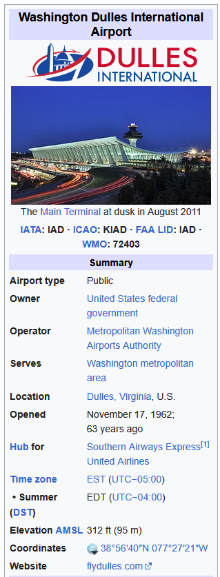
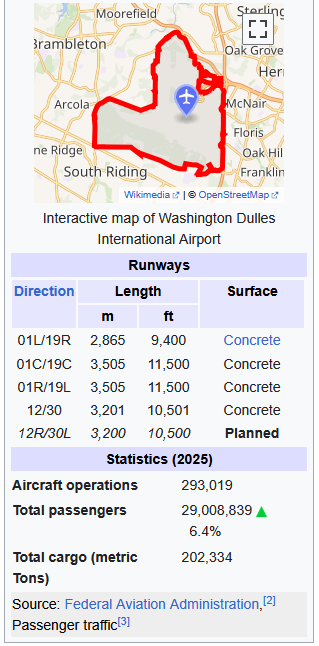

# Scraping Data

In applied economics research, the data needed to answer a question is rarely available in a single dataset: it is usually scattered across multiple sources. In @sec-datasets, we enriched a main dataset by merging it with a second, ready-made dataset. Often, however, the additional information we need is not available as a dataset at all, but only as web content. In this session, we learn how to collect such information from the web, store it in a dataframe, and merge it with our main dataset.

## Introduction

### Direct Download

Many websites offer a direct download of their data in a ready-to-use format, such as CSV or Excel. For example, the [Bureau of Transportation Statistics](https://www.transtats.bts.gov/) offers a direct download of the flights dataset we used in @sec-datasets. In that case, we can simply download the file and read it into R with `read.csv()` or `read_excel()`. However, many websites do not offer a direct download, and we have to collect the information from their web pages.

### API-s

Some websites offer an **API** (Application Programming Interface): a service designed for researchers to request data directly. We request the data by visiting a specific web address that describes what we want, and the API answers in a structured format, typically JSON, which R can convert into lists and dataframes. 

For example, the [OpenWeather API](https://openweathermap.org/api) provides current, forecast and historical weather data for any location in the world. The address `https://api.openweathermap.org/data/2.5/weather?q=New%20York&units=metric&appid=YOUR_KEY` asks for the current weather in New York, in metric units, and the answer contains the temperature, humidity, wind speed and cloud cover, with no layout or formatting to remove. The last part of the address, `appid`, is a personal key: like many APIs, OpenWeather asks users to register (for free) to obtain a key, which identifies who is requesting the data and limits how many requests each user can make. 

When a website offers an API, it is usually the better option: the data is cleaner, the format does not change when the website is redesigned, and the website controls how much data can be requested. Many data providers relevant for economists, such as the World Bank, Eurostat or the FRED database of the Federal Reserve, offer APIs. Scraping is the fallback for information that is only available on web pages.

### Webscrapping

A lot of useful information is available on websites but not as a downloadable or API-accessible dataset: it is displayed on web pages, written for people to read rather than for computers to analyse. **Web scraping** means writing code that visits these pages automatically, extracts the pieces of information we need, and stores them in a dataframe. A web page is written in HTML, a language that marks every part of the page (a title, a table, a row of a table) with a tag. A scraper reads the HTML of a page and uses these tags to find the information it is looking for, such as the value in the row labelled "Elevation" of a table.

## Webscrapping in R

Web scraping code can be written in many programming languages. Python is probably the most popular choice, with packages such as `requests`, `BeautifulSoup` and `Selenium`, and many online tutorials and examples are written in Python. The steps are the same in every language, though: request a page, read its HTML, extract the information, and store it in a dataset. In this course we stick to R, so that we can collect, clean, merge and analyse the data with the same tools we use for the rest of the course.

### Packages

In R, web scraping relies mainly on three packages:

| Package | What it does | Example functions |
|---------|--------------|-------------------|
| `rvest` | reads the HTML of a web page and extracts its parts, such as tables, rows or text | `read_html()` reads a page; `html_element()` and `html_elements()` select its parts; `html_text2()` extracts their text; `html_table()` turns an HTML table into a dataframe |
| `stringr` | cleans the extracted text, for example to keep only the number in "312 ft (95 m)" | `str_extract()` keeps the part of a text that matches a pattern; `str_remove_all()` deletes parts of a text; `str_detect()` checks whether a text contains a pattern |
| `httr` | sends requests to websites and to their APIs (services that return data directly, rather than a page to display) | `GET()` sends a request to a web address; `status_code()` checks whether it succeeded; `content()` extracts the answer |

Like `dplyr`, they are installed once with `install.packages()` and loaded with `library()` every time we use them:

```r
library(rvest)
library(httr)
library(stringr)
```

Writing a scraper used to be a **tedious process**, often requiring extensive programming skills: we had to study the HTML of the pages, find the tags that contain the information, and handle the many pages that do not follow the expected format. Large language models (LLMs) such as ChatGPT or Claude have made this much easier. We can describe in plain words what we want the code to do and let the LLM write it, an approach known as *vibecoding*. Vibecoding does not make our own understanding unnecessary, though: the code an LLM writes often runs without errors but returns incomplete or wrong information. We still need to read the code, check its output, and ask for corrections, as we will do in this session.

When scraping, keep in mind that each request uses the resources of the website. Scrapers should pause between requests and **respect the website's terms of use**.

### Base Dataset `flights`

Package `nycflights13` includes the The `flights` dataset, which contains information on all 336.776 flights departing from New York City airports (JFK, LGA, EWR) in 2013. The dataset contains the following 19 variables:

- `year`, `month`, `day`: date of departure.
- `dep_time`, `arr_time`: actual departure and arrival times, in local time, written as HHMM (e.g. 517 means 5:17).
- `sched_dep_time`, `sched_arr_time`: scheduled departure and arrival times, in the same format.
- `dep_delay`, `arr_delay`: departure and arrival delays, in minutes. Negative values mean the flight departed or arrived early.
- `carrier`: two-letter code of the airline (e.g. `UA` for United Airlines).
- `flight`: flight number.
- `tailnum`: tail number, which identifies the plane.
- `origin`, `dest`: three-letter codes of the airports of origin and destination.
- `air_time`: time spent in the air, in minutes.
- `distance`: distance between the two airports, in miles.
- `hour`, `minute`: scheduled departure time, split into hours and minutes.
- `time_hour`: scheduled date and hour of departure, stored as a date-time variable.

```{r}
library(nycflights13)
data("flights")
dim(flights)
head(flights)
names(flights)
```

Let us take a first look to the origin and destination airports in the `flights` dataset:

```{r}
table(flights$origin, flights$dest)
```

### Complementary Dataset: `airports`

We want to study how airport features determine flight delays. To do this, we need to enrich the `flights` dataset with additional information about each airport features, such as its location, altitude, and runway information. The `nycflights13` package contains a complementary dataset called `airports`, which contains some of this information for all airports in the United States. It has 1,458 rows (one per airport) and the following 8 variables:

```{r}
data("airports")
dim(airports)
head(airports)
names(airports)
```

- `faa`: three-letter FAA code of the airport (e.g. `JFK`). It matches the `origin` and `dest` variables of `flights`, so it is the key for merging the two datasets.
- `name`: name of the airport.
- `lat`, `lon`: latitude and longitude of the airport, in decimal degrees. Longitudes west of Greenwich are negative, so all US airports have a negative longitude.
- `alt`: altitude above sea level, in feet.
- `tz`: time zone, as the difference from GMT in hours (e.g. −5 for New York).
- `dst`: daylight saving time rule: `A` for the standard US rule, `N` for no daylight saving time (e.g. Hawaii), `U` for unknown.
- `tzone`: name of the time zone (e.g. `"America/New_York"`).

We want to further enrich the `airports` dataset with additional information about each airport infrastructure, such as its number of runways and their longitude. To do this, we will create an a webscraping script to extract this information from each airport's wikipedia page. For example, the pictures below show the information box of the Wikipedia page of [Washington Dulles International Airport](https://en.wikipedia.org/wiki/Dulles_International_Airport).

::: {layout-ncol=2 layout-valign="top"}
{fig-alt="Wikipedia infobox for Washington Dulles International Airport: photo of the main terminal, airport codes, owner, operator, location, opening date, elevation and coordinates."}

{fig-alt="Wikipedia infobox for Washington Dulles International Airport, continued: map of the airport, table of runways, and 2025 statistics on aircraft operations, passengers and cargo."}
:::

## Vibecoding a Scraper

Generate a prompt to your LLM of choice, asking to create a webscraper that extracts the following information from each airport's Wikipedia page:

### First Attempt

```{r}
# Keep only the airports that appear in flights, as origin or destination
airports <- airports[airports$faa %in% c(flights$origin, flights$dest), ]
nrow(airports)
head(airports$faa)
```

::: {.prompt-box}
*I am working on R. I have a list of unique airport codes from the flights dataset `airports$faa`. with elements of the list that look as follows: "ABQ" "ACK" "ALB" "ANC" "ATL" "AUS"... I want to extract information about each airport from its Wikipedia page. Write an R script that loops through the list, scrapes the Wikipedia pages (e.g., [https://en.wikipedia.org/wiki/](https://en.wikipedia.org/wiki/) + airport code), extracts: 1) the number of runways in the airport, 2) the length of each runway, in metres, from the Wikipedia infobox.*
:::

A minimal version of the resulting scraper uses the `rvest` package, which reads a web page and extracts its parts. It is far from perfect: airports whose page is not found are skipped, and airports whose page has no runway table get 0 runways. Since the number of runways differs across airports, the lengths are stored as a single text, separated by semicolons:

```{r}
#| cache: true
library(rvest)

# Empty dataframe to store the results, one row per airport
df_airports_wiki <- data.frame()

for (code in airports$faa) {

  # Read the Wikipedia page of the airport code; skip the code if the page does not exist
  page <- tryCatch(read_html(paste0("https://en.wikipedia.org/wiki/", code)),
                   error = function(e) NULL)
  if (is.null(page)) next

  # Rows of the runway table, inside the infobox at the top right of the page
  rows <- html_text2(html_elements(page, "table.infobox table tr"))

  # Runway rows start with a runway direction, e.g. "4L/22R  3,353  11,000  Asphalt"
  runways <- strsplit(rows[grepl("^[0-9]+[LCR]?/[0-9]+", rows)], "\t")

  # Lengths in metres: 2nd column, or 3rd if the table lists feet first
  m_col     <- if ("ft\tm" %in% rows) 3 else 2
  lengths_m <- sapply(runways, function(r) r[m_col])

  df_airports_wiki <- rbind(df_airports_wiki, data.frame(
    airport_code    = code,
    n_runways       = length(runways),
    runway_length_m = paste(lengths_m, collapse = "; ")
  ))

  Sys.sleep(0.5) # wait half a second between pages, to be polite to Wikipedia
}

head(df_airports_wiki)
```

Let us start by testing the coverage of the `n_runways` variable: 

```{r}
table(is.na(df_airports_wiki$n_runways))
```

The `n_runways` variable coverage seems to be perfect, but is it?

```{r}
table(df_airports_wiki$n_runways)
```

What about the `runway_length_m` variable? It is a text variable, so we cannot use `summary()` to see its distribution. Instead, we can check how many airports have no runway length recorded:

```{r}
head(df_airports_wiki[df_airports_wiki$n_runways != 0, ])
```

Lastly, how well did the scraper record the Dulles International Airport (IAD) information? The airport has 4 runways, with lengths 11,500; 11,500; 10,501; 10,501 feet (3,505; 3,505; 3,200; 3,200 metres). Did the scraper get it right?

```{r}
print(df_airports_wiki[df_airports_wiki$airport_code == "IAD", ])
```

To sum up, the vibecoded scraper did record the runway information for a few airports, but most airports were not recorded properly. More worryingly, the failure is easy to miss: even when the scraper could not find any information about an airport, it still filled in the `n_runways` variable, recording 0 runways. Every airport therefore has a value, and at first glance the scraper seems to have done a great job. This is a general lesson about AI-generated code: a script that runs without errors and returns a complete dataset is not necessarily correct, and its output must always be checked against cases we already know, as we did with Dulles.

### Second Attempt

After this first attempt, we can refine the scraper to improve its coverage. For that purpose, we are going to generate a list of the airport codes that were not found in the previous attempt:

```{r}
df_airports_not_found <- df_airports_wiki$airport_code[df_airports_wiki$n_runways == 0]
print(df_airports_not_found)
```

After that, we can generate a new prompt to the LLM, asking it to improve the scraper:

::: {.prompt-box}
*The previous scraper missed the following airports: [paste the list of missed airports here]. Moreover, I want that, if you are unable to find a specific variable, such as no airport runaways n_runways, you record "NA" value instead of 0. If the number of runways is NA, record the runaway length variable runway_length_m  as "NA". Generate a new version of the scraper.*
:::

```{r}
#| cache: true
library(rvest)
library(httr)

# Empty dataframe to store the results, one row per airport
df_airports_wiki2 <- data.frame()

for (code in airports$faa) {

  # New: instead of guessing the page address, ask Wikipedia's search engine
  # for "<code> airport" and take the title of the first result
  search_url <- paste0("https://en.wikipedia.org/w/api.php?action=query&list=search",
                       "&format=json&srsearch=", code, "%20airport")
  title <- tryCatch(content(GET(search_url))$query$search[[1]]$title,
                    error = function(e) NULL)

  # Read the Wikipedia page of that title (NULL if the search or the page fails)
  page <- if (is.null(title)) NULL else
    tryCatch(read_html(paste0("https://en.wikipedia.org/wiki/", URLencode(title))),
             error = function(e) NULL)

  # New: if the page is not found, keep the airport in the dataset with NA values
  if (is.null(page)) {
    df_airports_wiki2 <- rbind(df_airports_wiki2, data.frame(
      airport_code = code, airport_name = NA, n_runways = NA, runway_length_m = NA))
    next
  }

  # Rows of the runway table, inside the infobox at the top right of the page
  rows <- html_text2(html_elements(page, "table.infobox table tr"))

  # Runway rows start with a runway direction, e.g. "4L/22R  3,353  11,000  Asphalt"
  runways <- strsplit(rows[grepl("^[0-9]+[LCR]?/[0-9]+", rows)], "\t")

  # Lengths in metres: 2nd column, or 3rd if the table lists feet first
  m_col     <- if ("ft\tm" %in% rows) 3 else 2
  lengths_m <- sapply(runways, function(r) r[m_col])

  # New: NA instead of 0 if no runways are found, and then also NA for their lengths
  n_runways       <- if (length(runways) == 0) NA else length(runways)
  runway_length_m <- if (is.na(n_runways)) NA else paste(lengths_m, collapse = "; ")

  df_airports_wiki2 <- rbind(df_airports_wiki2, data.frame(
    airport_code    = code,
    n_runways       = n_runways,
    runway_length_m = runway_length_m
  ))

  Sys.sleep(1) # wait one second between pages, to be polite to Wikipedia
}
```

The resulting dataset `df_airports_wiki2` now looks like this:
```{r}
head(df_airports_wiki2)
```

```{r}
table(is.na(df_airports_wiki2$n_runways))
table(df_airports_wiki2$n_runways)
```

Sanity check: did the scraper accurately register the [Dulles International Airport (IAD)](https://en.wikipedia.org/wiki/Dulles_International_Airport) information?

```{r}
print(df_airports_wiki2[df_airports_wiki2$airport_code == "IAD", c("airport_code", "n_runways", "runway_length_m")])
```

## Final Dataset

Remember, `df_airports_wiki2` is a complement. We now have to merge it with the base dataset `nycflights13` to create a final dataset that contains all the information we need for our analysis.

Each flight involves two airports, so the information in `df_airports_wiki2` has to be merged **twice**: once for the airport of origin and once for the airport of destination. To tell the two apart in the final dataset, we first select the variables we need and rename them with the prefix `origin_`. The key variable is renamed `origin`, as in `flights`, so that the two datasets can be matched by that name:

```{r}
library(dplyr)

# Airport information, with variable names referring to the airport of origin
df_origin <- df_airports_wiki2 |>
  select(origin                 = airport_code,
         origin_n_runways       = n_runways,
         origin_runway_length_m = runway_length_m)

df_flights <- flights |>
  left_join(df_origin, by = "origin")
```

A left join keeps every flight, so `df_flights` has the same number of rows as `flights`, plus the new variables:

```{r}
dim(flights)
dim(df_flights)
```

All flights depart from one of the three New York airports, so the origin variables should only take three different values:

```{r}
table(df_flights$origin, df_flights$origin_n_runways)
```

Second step, enrich the dataset with the airport of destination information, following the same steps with the prefix `dest_`:

```{r}
# Airport information, with variable names referring to the airport of destination
df_dest <- df_airports_wiki2 |>
  select(dest                 = airport_code,
         dest_n_runways       = n_runways,
         dest_runway_length_m = runway_length_m)

df_flights <- df_flights |>
  left_join(df_dest, by = "dest")

dim(df_flights)
head(df_flights[, c("origin", "dest", "origin_n_runways", "dest_n_runways", "dep_delay")])
```

Let us test the coverage of the runway variables:

```{r}
table(is.na(df_flights$dest_n_runways), is.na(df_flights$origin_n_runways))
```

Finally, we can save the enriched dataset to a CSV file for later use, The dataset will be stored in the default working directory:

```r
# Get the default working directory printed:
getwd()
```
```{r}
# Saving dataset df_flights:
write.csv(df_flights, "data/df_flights_enriched.csv", row.names = FALSE)
```

Next class: Once our data is assembled and cleaned, we can start exploring it. We will learn how to create summary tables and visualizations to understand the relationships between economically relevant variables.
